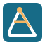

# ImovelGEO Ferramentas

   

   <strong>Atalhos para ferramentas de produção cadastral, reunidos em um menu organizado no QGIS.</strong>

   
   
   

## Visão geral

**ImovelGEO Ferramentas** é um complemento para QGIS que reúne comandos usados na rotina de produção do ImovelGEO. Ele organiza as ações por origem, abrindo as ferramentas nativas do QGIS e os algoritmos do complemento LF Tools a partir de um único menu.

O plugin não substitui nem reimplementa essas ferramentas: ele cria atalhos para os diálogos oficiais de processamento e para as ações disponibilizadas pelos complementos instalados no QGIS.

## Funcionalidades

### Ferramentas QGIS

- **Poligonizar** (`native:polygonize`): cria polígonos a partir de regiões raster conectadas.
- **Recortar** (`native:clip`): recorta uma camada vetorial usando outra como máscara.
- **Corrigir geometria** (`native:fixgeometries`): corrige geometrias inválidas.
- **Georreferenciamento**: abre o Georreferenciador nativo do QGIS.

### Ferramentas LF Tools

- **Azimute e Distância**.
- **Poligonal Fechada**.

Os algoritmos do LF Tools são localizados no registro de processamento pelo provedor `lftools` e pelo nome exibido. Se o complemento não estiver instalado ou habilitado, o plugin apresenta um aviso.

## Organização do menu

~~~text
ImovelGEO Ferramentas
├── QGIS
│   ├── Poligonizar
│   ├── Recortar
│   ├── Corrigir geometria
│   └── Georreferenciamento
└── LF Tools
      ├── Azimute e Distância
      └── Poligonal Fechada
~~~

O menu é inserido depois de **CGGEO Tools 1.2**. Se esse menu não estiver disponível, **ImovelGEO Ferramentas** aparece no final da barra de menus do QGIS.

## Instalação

### Pelo arquivo ZIP

1. Baixe o arquivo [`ImovelGEO_Ferramentas.zip`](ImovelGEO_Ferramentas.zip) deste repositório.
2. No QGIS, abra **Complementos > Gerenciar e Instalar Complementos**.
3. Selecione **Instalar a partir do ZIP**.
4. Escolha o arquivo ZIP e conclua a instalação.
5. Habilite **ImovelGEO Ferramentas**, caso o QGIS não o faça automaticamente.

### Manualmente

1. Copie a pasta `imovelgeo_ferramentas` para a pasta de complementos do seu perfil QGIS:

    ~~~text
    %APPDATA%\QGIS\QGIS3\profiles\default\python\plugins
    ~~~

2. Reinicie o QGIS.
3. Acesse **Complementos > Gerenciar e Instalar Complementos** e habilite **ImovelGEO Ferramentas**.

## Como usar

1. Habilite o complemento **ImovelGEO Ferramentas** no gerenciador de complementos do QGIS.
2. Para os atalhos correspondentes, habilite também o complemento nativo **Georreferenciador** e o **LF Tools**.
3. Abra **ImovelGEO Ferramentas** na barra superior do QGIS.
4. Escolha o grupo **QGIS** ou **LF Tools** e clique na ferramenta desejada.

Os comandos de processamento abrem os diálogos oficiais do QGIS ou do LF Tools. O atalho de Georreferenciamento aciona a ação do complemento nativo.

## Requisitos

- QGIS 3.22 ou superior.
- Complemento **Georreferenciador** habilitado para usar o atalho de georreferenciamento.
- Complemento **LF Tools** instalado e habilitado para usar os atalhos desse grupo.

## Estrutura do projeto

~~~text
.
├── imovelgeo_ferramentas/
│   ├── __init__.py
│   ├── icon.svg
│   ├── imovelgeo_ferramentas.py
│   └── metadata.txt
├── ImovelGEO_Ferramentas.zip
└── README.md
~~~

## 📩 Contato

👤 **Rogerio Vidal de Siqueira**\
📧 rogeriovidalsiqueira@gmail.com\
🔗 [LinkedIn](https://www.linkedin.com/in/rogerio-vidal-de-siqueira-9478aa136/) | [GitHub](https://github.com/rvidals)

---

> “Com ciência, dados e colaboração, construímos cidades mais resilientes!” 🌱🌏
